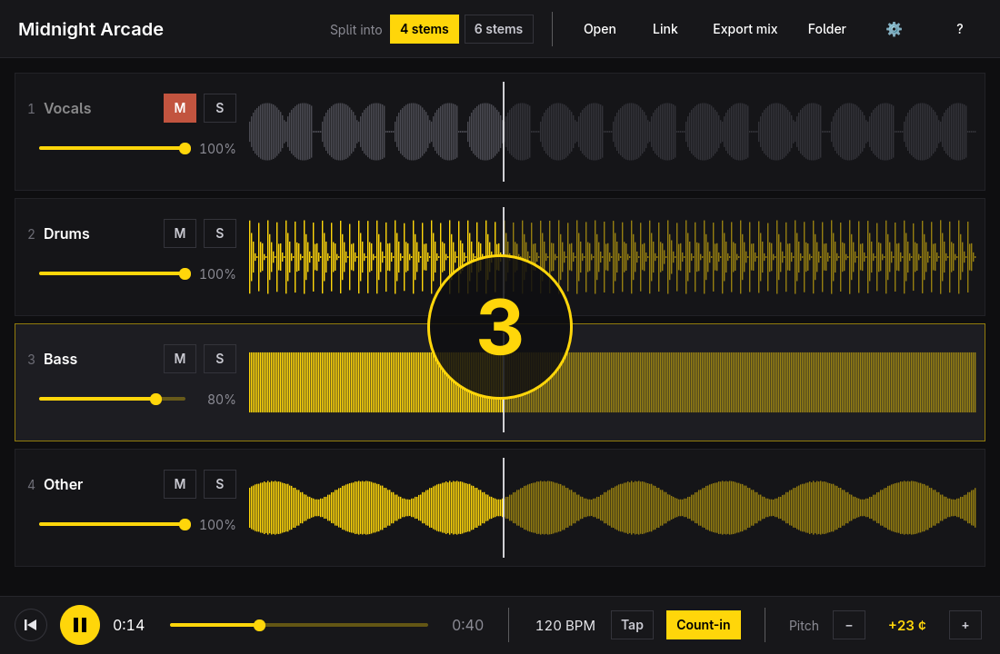

# Stems



Stems splits a song into its instruments and plays them back together, so you
can solo the bass line, mute the vocals for karaoke, or hear what the drummer
is doing. Open an MP3 (or FLAC, WAV, OGG, M4A…), or paste a YouTube link, and
[Demucs](https://github.com/adefossez/demucs) separates it into vocals, drums,
bass and everything else. Choose **6 stems** to also get guitar and piano.

A link is downloaded with [yt-dlp](https://github.com/yt-dlp/yt-dlp), just the
audio and without re-encoding, into `~/Music/Stems/Downloads/`, then split like
any other song. Press `Ctrl+V` with a link on the clipboard, press `L` to type
one, or drag a link from the browser onto the window. Anything yt-dlp can
read works, not only YouTube. Only download what you have the right to.

Every stem plays from one audio stream, so they stay sample-locked, and mute,
solo and volume take effect immediately. The pitch moves up or down by as much
as a half step (100 cents) without changing the tempo, using
[Rubber Band](https://breakfastquay.com/rubberband/), to match a detuned
recording or an instrument you're playing along on. What you hear, pitch
included, can be exported as a WAV file.

Stems finds each song's tempo in its drum stem (or in the whole song when
there's no drum stem) and shows it in BPM. Turn on **Count-in** (`C`) and
pressing play counts you in: clicks at the song's tempo, then the song comes
in on the beat. From the top, the count leads straight into the song's first
note, whichever stem plays it. Playing from the middle of a song backs up to the nearest beat
first, and the count follows the tempo where you start, so it keeps up with a
drummer who speeds up. Choose 2, 4 or 8 clicks in Settings. If the tempo is
wrong (half or double is the usual mistake) or there are no drums, tap along
with **Tap** (`B`): taps made while the song plays also set where the beats
fall. `Shift+B`, or double-clicking the tempo, goes back to the one found in
the drums.

Each song remembers its mix. The pitch, a tapped tempo, and every stem's
mute, solo and volume are saved to `mix.json` in the song's stems folder as
you change them, and come back the next time you open the song.

Stems are saved in `~/Music/Stems/<song>/`, one WAV per instrument, so each
song is split only once. Opening a song asks for 4 or 6 stems; if it's split
that way already, open those stems or split it again. **Split again** in the
header does the same for the open song. Splitting again replaces the stems and
keeps the saved mix and exports. Opening any stem in a stems folder goes
straight to the mixer. Your original file is never changed.

Switching between 4 and 6 stems with a song open loads its other split, or
asks to make one.

Settings (`,`) sets where stems go and lists the programs Stems needs
(Demucs, ffmpeg, uv, yt-dlp), with their versions and how to install any
that are missing. The command line uses the same folder.

## Install

```sh
bin/install
```

This builds the package and installs it with `makepkg -fsi`. Stems then shows
up in the Omarchy app launcher (`Super + Space`).

To upgrade a checkout you already installed:

```sh
bin/update
```

This fast-forwards the checkout, then runs `bin/install` again so the launcher
gets the new package. It stops when tracked files have local changes.
Arguments are passed through to `makepkg`, so `bin/update --noconfirm` works.
Pacman still asks for your password when it replaces the package.

Splitting needs Demucs. If it's missing, Stems says so and offers to install
it (press **I**), which runs:

```sh
uv tool install demucs --python 3.12 --with 'torch==2.8.*' --with 'torchaudio==2.8.*' \
  --with numpy --with soundfile \
  --index https://download.pytorch.org/whl/cpu --index-strategy unsafe-best-match
```

That is a CPU-only PyTorch, about 1 GB, installed in your home folder. The
first split also downloads the model, about 80 MB. On a laptop-class CPU,
splitting takes roughly as long as the song.

Links need yt-dlp, which the package installs. YouTube changes often enough
that an old yt-dlp stops working; if downloads start failing, update it with
your system (`omarchy-update`).

## Keys

| Key | Action |
| --- | --- |
| `Space` | Play or pause (open a song when none is loaded) |
| `O` | Open a song or a stems folder (or drop one on the window) |
| `L` | Split a song from a YouTube link |
| `Ctrl+V` | Split the YouTube link on the clipboard |
| `1`–`6` | Mute a stem |
| `Ctrl+1`–`6` | Solo a stem |
| `↑` `↓` / `K` `J` | Select a stem |
| `M` / `S` | Mute or solo the selected stem |
| `+` / `-` | Selected stem louder or quieter |
| `[` / `]` | Pitch down or up 10 cents |
| `{` / `}` | Pitch down or up 1 cent |
| `\` | Reset the pitch (or double-click it) |
| `0` | Reset the mix and the pitch |
| `←` `→` | Back or forward 5 seconds |
| `Shift+←` `→` | Back or forward 30 seconds |
| `Home` | Back to the start |
| `E` | Export what's audible as a WAV |
| `T` | Switch between 4 and 6 stems |
| `,` | Settings |
| `F` | Show the stems folder |
| `I` | Install Demucs |
| `Ctrl+Z` / `Ctrl+Shift+Z` | Undo or redo a mix change |
| `Esc` | Cancel the download or the split |
| `?` | Show every shortcut |
| `Q` | Quit |

Click or drag on a waveform to seek.

## Command line

Every command works without a display, takes `--json`, and exits 0 or 1:

```sh
stems check                                   # Is Demucs installed?
stems split song.mp3 [--six]                  # Split into ~/Music/Stems/song/
stems split 'https://youtu.be/…'              # Download the audio, then split it
stems mix ~/Music/Stems/song --mute vocals -o karaoke.wav
stems mix ~/Music/Stems/song --solo drums,bass -o rhythm.wav
stems mix ~/Music/Stems/song --saved -o as-i-left-it.wav    # The mix saved in the app
stems mix ~/Music/Stems/song --cents -100 -o down-a-half-step.wav
stems skill install                           # Teach coding agents to use stems
stems open song.mp3                           # The app, with that song (or a link)
```

Stems keeps to one window. With Stems already open, `stems open song.mp3` (or
opening a song from a file manager) hands the song to that window. If a split
or download is running there, Stems asks before stopping it.

## Development

```sh
bin/build    # build/stems
bin/test     # Qt Test, offscreen
```

C++ and Qt Quick, built with qmake6. The window follows the Omarchy theme's
accent color and window rounding, and the language picked under Setup >
Language (English, Danish, German, Spanish, French, and Portuguese so far).

## License

MIT. The theme follower, the language follower and the portal file picker are
adapted from [Omacut](https://github.com/omacom-io/omacut) by David Heinemeier
Hansson, also MIT.
